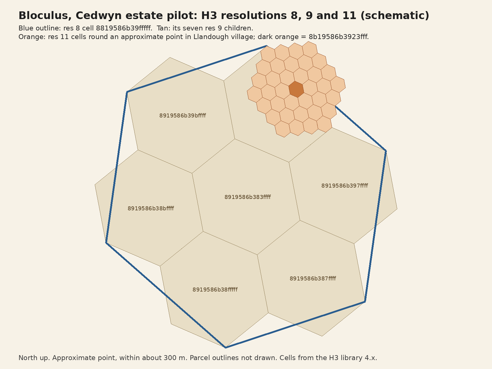

Annexures
===========

This section contains the Annexures referenced in the text above.
The :ref:`Download Links` for these Annexures can be found at the very end of this document.

H3 layers over the pilot area (Resolutions 8, 9 and 11)
~~~~~~~~~~~~~~~~~~~~~~~~~~~~~~~~~~~~~~~~~~~~~~~~~~~~~~~~~~

A schematic of the H3 hierarchy around an approximate point near the centre of Llandough village: the resolution 8 cell (about 531 m edge),
its resolution 9 children (about 201 m edge) and the resolution 11 cells (about 29 m edge) proposed for parcel centre points.
Parcel outlines are not drawn; they will be added once the 59 parcels are traced and sourced.

Download Links
~~~~~~~~~~~~~~~~

See below a table of the download links for the Annexed items in this document:

.. csv-table:: Download Link of Annexures
   :file: _static/annex.csv
   :widths: 20, 35, 15, 15, 15
   :header-rows: 1
